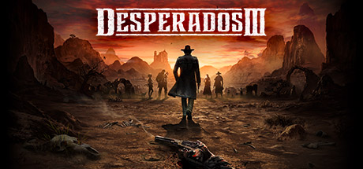

**Desperados III is a real-time tactics stealth game set in the Wild West, where a team of five outlaws with unique abilities must coordinate to clear enemy-filled levels. Features the Showdown Mode that lets you pause and plan simultaneous actions.**

---

## 📖 About

Desperados III is a real-time tactics stealth game set in the Wild West, where a team of five outlaws with unique abilities must coordinate to clear enemy-filled levels. Features the Showdown Mode that lets you pause and plan simultaneous actions.

## ⚠️ Problems Without Trainer

| Problem | Status |
|---------|--------|
| **Enemy Vision Cones** — Overlapping guard sight lines create complex alert management puzzles | ✅ Solved |
| **Challenge Missions** — Optional hardcore missions with specific character or kill restrictions | ✅ Solved |
| **Quick Reaction Times** — Alerts spread instantly; failing one patrol can chain-fail entire levels | ✅ Solved |
| **Wanted Conditions** — Some story missions penalize specific approaches significantly | ✅ Solved |

## ✅ Solution

The **Desperados III Trainer** solves all these issues by giving you complete control over the game.

## 🎯 Full Feature List

- Unlimited Resources
- God Mode / Invincibility
- Instant Skill Cooldown
- One-Hit Kill
- Freeze Game Timer
- Unlock All Items & Achievements
- Custom Speed Multiplier
- Save State Anywhere

## 🚀 Quick Start

1. **Disable Windows Defender** temporarily (trainer may trigger false positive)
2. Download the trainer from the button above
3. Launch Desperados III
4. Run the trainer as Administrator
5. Activate desired cheats with hotkeys

## 💎 Free vs Paid

| Feature | Free | Pro |
|---------|------|-----|
| Basic God Mode | ✅ | ✅ |
| Unlimited Resources | ✅ | ✅ |
| All Advanced Cheats | ❌ | ✅ |
| Auto-Updates | ❌ | ✅ |
| Priority Support | ❌ | ✅ |

## 💻 Requirements

- Windows 10/11 (64-bit)
- Desperados III (any version)
- .NET Framework 4.8+
- DirectX 11+

## 🍎 macOS

macOS users can use our alternative tool:

## ⚖️ Legal

This trainer is for educational and single-player use only. Use responsibly.

---

